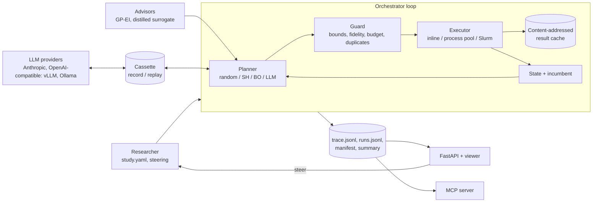

# Architecture

## Design decisions

**Budget accounting is separate from planning.** A `BudgetLedger` reserves the cost of every run the guard
accepts and commits it after execution (a cache hit commits zero), so `committed + reserved <= total` holds at every
instant, even mid-batch and whatever an LLM proposes. Property-based tests throw random and adversarial proposals at
the guard and the ledger. The LLM's USD cap is checked *before* each call with a worst-case estimate (prompt length
plus `max_tokens`), so a call that could break the cap is never made.

**Planners propose, the guard disposes.** Every planner, including an LLM, only returns a *proposal*. A
deterministic guard enforces parameter bounds (including bounds the researcher narrowed mid-run), valid
fidelities, batch size, the remaining compute budget, and de-duplication of deterministic runs. Every
intervention is a `guard` event in the trace, so you can see how often an LLM tried to overspend.

**Declared costs, measured times.** Budgets use each fidelity's declared cost so that a campaign is
reproducible across machines. Wall-clock is still measured and recorded on every run.

**The incumbent is the best result at the highest fidelity evaluated.** This keeps planners honest: a
cheap, biased fidelity cannot produce the reported answer unless nothing better was checked (see the reactor
task, where explicit Euler over-estimates the yield near the optimum).

**Reproducibility is tested, not claimed.** Each run writes its spec, a manifest (package versions, git
SHA, spec digest), and a `results_digest` over what was run and what came out. Seeds are derived from
`(study seed, run index)`. LLM calls are recorded to a cassette keyed by a hash of the exact request;
`sciagent replay <run>` re-executes a campaign from the cassette and fails if the digest differs. The test
suite does this for LLM and non-LLM planners.

**Inspectable by people and by agents.** The same trace feeds the CLI timeline (`sciagent trace`), the web
viewer (`sciagent serve`) and MCP tools (`study_trace`), so a researcher or another agent can audit and
steer a run.

**Redirect and resume.** A steering instruction can switch the planner mid-run; the new planner sees the full
history. `sciagent resume` continues an interrupted study in place by fast-forwarding: the planner is driven through
its earlier decisions again, each re-proposed run is answered from `runs.jsonl`, LLM calls from the cassette, and
steering is re-applied at its original batch. The test suite simulates a preemption for each planner type and checks
the resumed result is identical to an uninterrupted run.

**Graceful degradation.** Malformed LLM output gets a bounded repair loop; repeated failure ends the
campaign with a recorded reason instead of a crash; an exhausted LLM budget can fall back to BO.

## Event kinds in `trace.jsonl`

| kind | emitted when | key fields |
|---|---|---|
| `study.start` / `study.end` | campaign boundaries | budget, spec digest / summary |
| `batch.start` / `batch.end` | each planning round | spent, incumbent |
| `llm.call` | each model call (incl. repairs) | model, tokens, attempt, replayed, response |
| `plan` | a proposal | planner, rationale, proposed runs, usage |
| `guard` | the guard changed a proposal | per-run action and reason |
| `run` | a simulation finished | params, fidelity, seed, objective, metrics, cost, cached |
| `execute` | a batch was dispatched | executor, jobs, cache hits, seconds |
| `steer` / `pause` | researcher intervention | what was applied, batch, replayed |
| `resume` / `resume.diverged` | a study was resumed / the planner left the recorded path | recorded runs |
| `interrupted` | the process was stopped (Ctrl-C, preemption) | batch |
| `error` | the orchestrator itself failed | exception |
